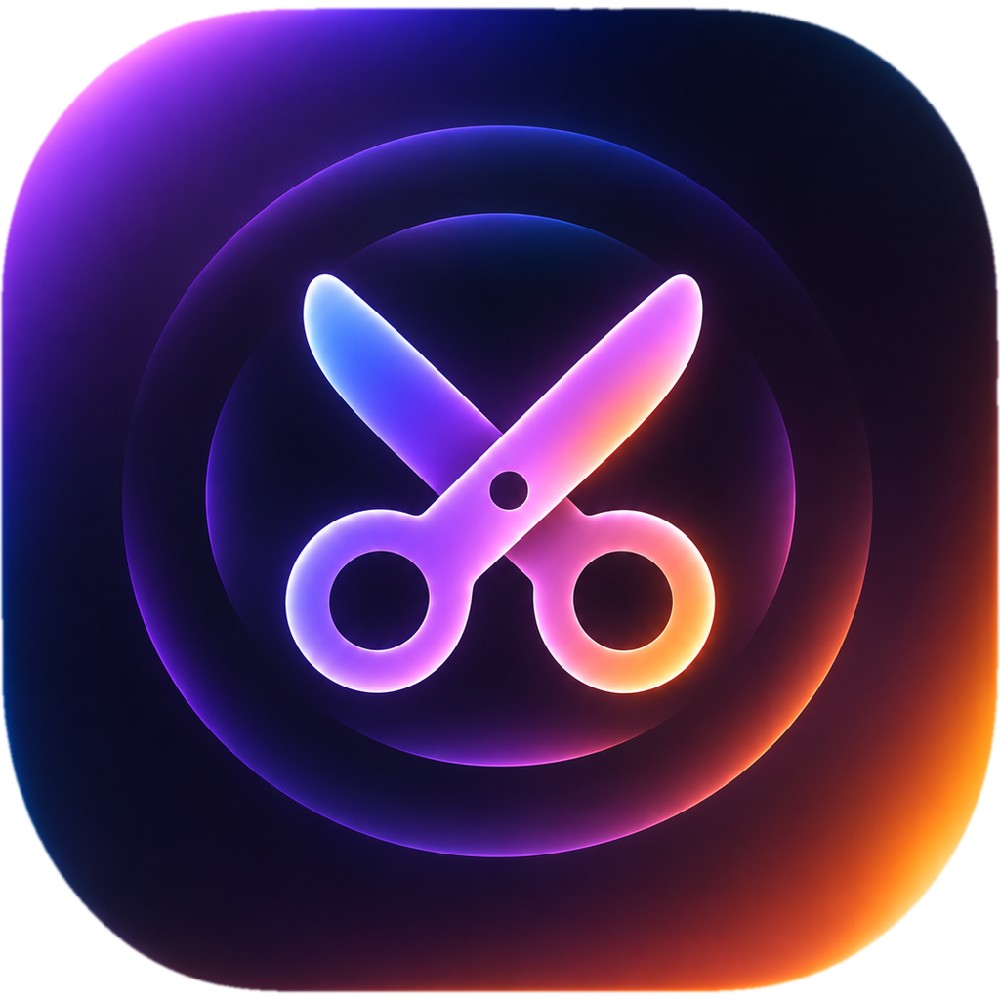
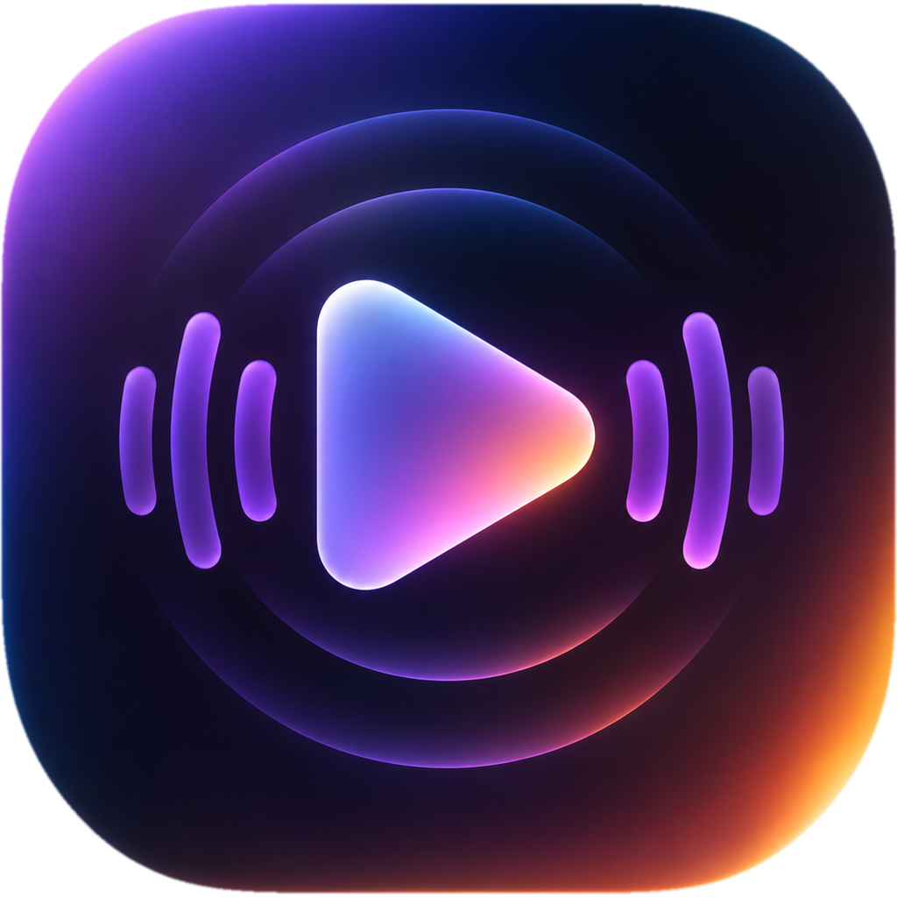

<p align="center">
  
  &nbsp;
  
</p>

<h1 align="center">Feel (Beta)</h1>

<p align="center">
  Make haptics for a video. Edit on a Mac. Feel on a phone.
</p>

<p align="center">
  macOS &nbsp;·&nbsp; iOS &nbsp;·&nbsp; Android
</p>

<p align="center">
  <a href="#features">Features</a> &nbsp;·&nbsp;
  <a href="#apps">Apps</a> &nbsp;·&nbsp;
  <a href="#usage">Usage</a> &nbsp;·&nbsp;
  <a href="#build">Build</a> &nbsp;·&nbsp;
  <a href="PRIVACY.md">Privacy</a>
</p>

<br>


> [!NOTE]
> This project is in beta. Tests on a Pixel 6a, tests on a physical iPhone, and tests with many phones at the same time are complete.

## Features

- **Haptic timeline:** Edit haptic events on a timeline that aligns with the video.
- **Presets:** Add haptic patterns from a preset list.
- **Suggestions:** Get haptic suggestions from the video and audio.
- **Live preview:** Connect phones to the Mac and feel the haptics during playback.
- **Export:** Export haptics as AHAP, JSON, Swift playback code, or Kotlin playback code.

## Apps

| App | Function | Minimum version | Source |
| --- | --- | --- | --- |
| **Feel Editor** | Edits, analyzes, and exports haptics. | macOS 14 | `Apps/FeelMac` |
| **Feel Player** | Plays a video and sends haptics to connected phones. | macOS 14 | `Apps/FeelPlayer` |
| **Feel for iPhone** | Plays haptics with Core Haptics. | iOS 17 | `Apps/FeelPhone` |
| **Feel for Android** | Plays haptics with the device vibrator. | Android 8.0 (API 26) | `Apps/FeelAndroid` |

The Apple apps share the Swift package in `Packages/FeelCore`. This package contains the models, timebase, presets, export engine, and network protocol.

## Usage

### Edit haptics on a Mac

1. Start Feel Editor and import a video.
2. Connect the Mac and the phone to the same network.
3. Open the phone app and scan the QR code that shows in Feel Editor.
4. Edit the timeline. The phone plays the haptics in sync with the video.
5. Export the haptics.

### Use a phone without a Mac

1. Open the phone app.
2. Select a video. 
3. Feel the haptics

### Export haptics

1. Start Feel Editor and open your project.
2. In the toolbar, click **Export**.
3. Select one or more formats.
4. Click **Export…**.
5. Select a folder, then click **Export Here**.

Feel Editor writes these files:

| Format | Files | Platform | Use |
| --- | --- | --- | --- |
| AHAP | `<project>.ahap` | iOS | Play the pattern with Core Haptics. There is no video sync. |
| JSON | `<project>.json` | iOS, Android | Open the file in Feel for iPhone or Feel for Android. |
| Swift playback code | `FeelHapticVideoSync.swift`, `<project>.ahap` | iOS 16 or later | Add haptics to your iOS app. Sync with `AVPlayer`. |
| Kotlin playback code | `FeelHapticVideoSync.kt`, `<project>.json` | Android 8.0 (API 26) or later | Add haptics to your Android app. Sync with a Media3 player. |

> [!WARNING]
> Export replaces files that have the same name in the selected folder. Export the haptics to an empty folder if you must keep the old files.

Export stops if the project has no events, or if an event has an invalid number. Export continues, and shows a warning, if:

- An event starts after the video ends, or continues after the video ends.
- An event has zero intensity.
- The project has no video.

### Add haptics to an iOS app

You do not have to install a library. The exported file contains all of the code.

1. Export with the **Swift playback code** format.
2. Add `FeelHapticVideoSync.swift` and `<project>.ahap` to your app target in Xcode.
3. Create the sync object. Use the name of your file, without the extension:

   ```swift
   let player = AVPlayer(url: videoURL)
   let haptics = try HapticVideoSync(player: player, resource: "<project>")
   player.play()
   ```

4. Keep a strong reference to `haptics` while the video plays. If you do not keep a reference, the haptics stop.

The haptics follow play, pause, seek, and rate changes. Use `HapticVideoSync.isSupported` to find out if the device has Core Haptics.

### Add haptics to an Android app

You do not have to install a Feel library. The exported file contains all of the code. Your app must use Media3 to play the video.

1. Export with the **Kotlin playback code** format.
2. Copy `FeelHapticVideoSync.kt` to your source folder. Use this folder:

   ```text
   app/src/main/java/com/feelplayer/haptics/
   ```

3. Copy `<project>.json` to the assets folder. If the folder does not exist, create it:

   ```text
   app/src/main/assets/
   ```

4. In `app/build.gradle.kts`, add Media3:

   ```kotlin
   dependencies {
       implementation("androidx.media3:media3-exoplayer:1.8.0")
   }
   ```

5. In `AndroidManifest.xml`, add this permission:

   ```xml
   <uses-permission android:name="android.permission.VIBRATE" />
   ```

6. Import the class in your activity:

   ```kotlin
   import com.feelplayer.haptics.HapticVideoSync
   ```

7. Create the sync object after you create the player. Use the full name of your file, with the extension:

   ```kotlin
   val player = ExoPlayer.Builder(this).build()
   val haptics = HapticVideoSync.fromAsset(this, player, "<project>.json")

   player.setMediaItem(MediaItem.fromUri(videoUri))
   player.prepare()
   player.play()
   ```

8. Keep a reference to `haptics` while the video plays.
9. When you close the screen, release the two objects in this sequence:

   ```kotlin
   haptics.release()
   player.release()
   ```

The haptics follow play, pause, buffering, seek, and speed changes. If the file is not a Feel haptics file, `fromAsset` throws `IllegalArgumentException`. If the file does not contain valid JSON, or does not have a list of events, `fromAsset` throws `JSONException`. If the file is not in the assets folder, `fromAsset` throws `FileNotFoundException`. Use `haptics.isSupported` to find out if the device has a vibration motor.

> [!NOTE]
> The **Media vibration** setting on the device controls the strength of these haptics. If the user sets it to off, the haptics do not operate. On a Pixel, this setting is in **Settings > Sound & vibration > Vibration & haptics**. The name and location can be different on other devices.

A system vibration, such as a touch vibration, can stop the haptics for a maximum of 1.5 seconds. The haptics then start again automatically.

## Build

### Apple apps

You must have a Mac with macOS 14 or later, Xcode, and [XcodeGen](https://github.com/yonaskolb/XcodeGen).

```sh
brew install xcodegen
xcodegen generate
open Feel.xcodeproj
```

Select one of these schemes:

| Scheme | App |
| --- | --- |
| `FeelEditor` | Feel Editor |
| `FeelPlayer` | Feel Player |
| `FeelPhone` | Feel for iPhone |

To run an app on a device, set your signing team and bundle IDs in `project.yml`. Then generate the project again.

### Android app

You must have JDK 17 and the Android SDK. Open `Apps/FeelAndroid` in Android Studio, or use this command:

```sh
cd Apps/FeelAndroid && ./gradlew assembleDebug
```

### Tests

```sh
# Shared Swift package
cd Packages/FeelCore && swift test

# Android app
cd Apps/FeelAndroid && ./gradlew test
```

## Security and privacy

- A pre-shared key (TLS-PSK) encrypts the connection between the devices. The QR code contains the pairing code.
- The apps keep a reference to each video. They do not copy the video.
- The apps do not collect your data. For more data, refer to the [privacy policy](PRIVACY.md).

## Contributing

Do not commit videos. Do not commit projects that you made from copyrighted media.

## License

This project has the AGPL-3.0-or-later license. For more data, refer to [LICENSE](LICENSE) and [NOTICE](NOTICE).

The AGPL does not apply to the "Feel", "Feel Editor", and "Feel Player" names, the app icons, or the bundle IDs. These items belong to 7 Angle. If you fork this project, you must use a different name, different icons, and different bundle IDs.
