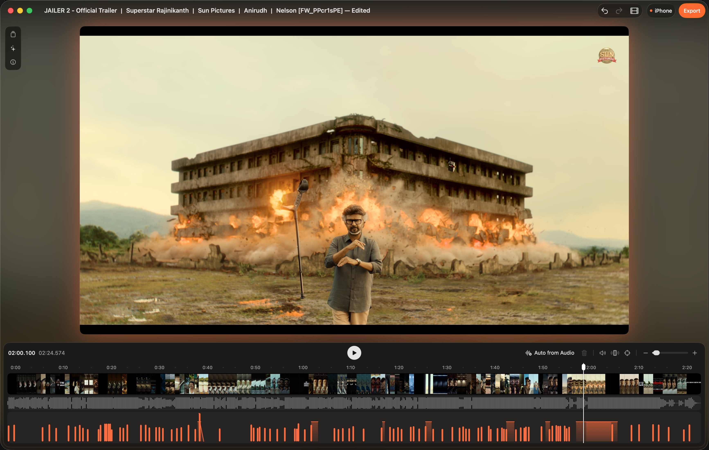

  
  &nbsp;
  

<h1 align="center">Feel (Beta)</h1>

  Make haptics for a video. Edit on a Mac. Feel on a phone.

  macOS &nbsp;·&nbsp; iOS &nbsp;·&nbsp; Android

  <a href="#features">Features</a> &nbsp;·&nbsp;
  <a href="#apps">Apps</a> &nbsp;·&nbsp;
  <a href="#usage">Usage</a> &nbsp;·&nbsp;
  <a href="#docs">Docs</a> &nbsp;·&nbsp;
  <a href="PRIVACY.md">Privacy</a>

 

> [!NOTE]
> This project is in beta. Tests on a Pixel 6a, tests on a physical iPhone, and tests with many phones at the same time are complete.

## Features

- **Haptic timeline:** Edit haptic events on a timeline that aligns with the video.
- **Presets:** Add haptic patterns from a preset list.
- **Suggestions:** Get haptic suggestions from the video and audio.
- **Live preview:** Connect phones to the Mac and feel the haptics during playback.
- **Export:** Export haptics as AHAP, JSON, Swift playback code, or Kotlin playback code.

## Apps

| App | Function | Minimum version | Source |
| --- | --- | --- | --- |
| **Feel Editor** | Edits, analyzes, and exports haptics. | macOS 14 | `Apps/FeelMac` |
| **Feel Player** | Plays a video and sends haptics to connected phones. | macOS 14 | `Apps/FeelPlayer` |
| **Feel for iPhone** | Plays haptics with Core Haptics. | iOS 17 | `Apps/FeelPhone` |
| **Feel for Android** | Plays haptics with the device vibrator. | Android 8.0 (API 26) | `Apps/FeelAndroid` |

The Apple apps share the Swift package in `Packages/FeelCore`. This package contains the models, timebase, presets, export engine, and network protocol.

## Usage

### Edit haptics on a Mac

1. Start Feel Editor and import a video.
2. Connect the Mac and the phone to the same network.
3. Open the phone app and scan the QR code that shows in Feel Editor.
4. Edit the timeline. The phone plays the haptics in sync with the video.
5. Export the haptics.

### Use a phone without a Mac

1. Open the phone app.
2. Select a video.
3. Feel the haptics.

## Docs

- [Export haptics](docs/export.md)
- [Add haptics to an iOS app](docs/ios.md)
- [Add haptics to an Android app](docs/android.md)
- [Build and test](docs/build.md)

## Security and privacy

- A pre-shared key (TLS-PSK) encrypts the connection between the devices. The QR code contains the pairing code.
- The apps keep a reference to each video. They do not copy the video.
- The apps do not collect your data. Feedback is optional. It goes to FeedbackJar only when you send it. For more data, refer to the [privacy policy](PRIVACY.md).

## Contributing

Do not commit videos. Do not commit projects that you made from copyrighted media.

## License

This project has the AGPL-3.0-or-later license. For more data, refer to [LICENSE](LICENSE) and [NOTICE](NOTICE).

The AGPL does not apply to the "Feel", "Feel Editor", and "Feel Player" names, the app icons, or the bundle IDs. These items belong to 7 Angle. If you fork this project, you must use a different name, different icons, and different bundle IDs.
